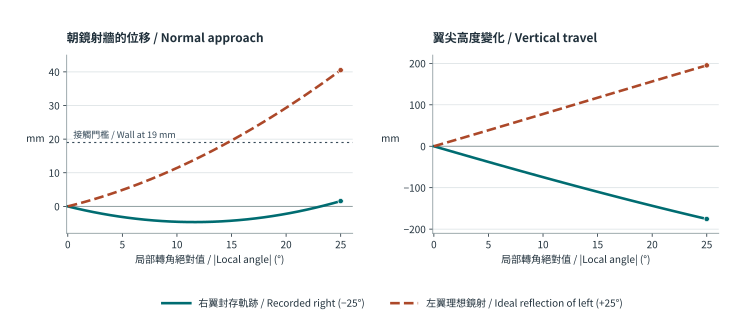

# Q 型龍娘 v48 測試基準

[English](Q_DRAGON_V48_TESTS_EN.md) · [v2.37 研究基線](README_ZH-TW.md) · [素材登錄](../../ASSETS.md)

2026 年 11 月 17 日，使用者指定 `GPT_Dragon_Q_G1_v48_Dressed.blend` 作為 Q 型龍娘的共同測試模型。Q 型參考身高沿用 0.90 m。站姿、骨架、翼尾形變、接觸位置及服裝交疊，都可從同一份模型建立可重跑的幾何證據。原始模型 SHA-256 為 `e9ce3129973ee9b9070bcd2d4540383a36a1f75d943670a9abb0b7f1f2b08f03`。實驗以原檔副本執行，保存各次匯出的輸入版本及雜湊。

## 已有的證據

- 交付包的 417 筆雜湊已核對。這裡用 Blender 4.3.2 試開時出現檔頭相容性錯誤。交接指定的 Blender 5.2.3 已成功開檔，第一輪結果見下節。完整材質重渲染待驗。
- 交付紀錄列有 80 根骨骼及舊版姿態測試。按包內同一個檢查式重算，指定坐姿的衣料交疊點由 v47 的 22,242 降為 v48 的 134，全部在上衣下緣。龍尾在同姿勢仍有 702 個交疊點。膝彎 120° 的衣服交疊由 6,200 增至 6,355，保留為極端姿勢的回歸對照。這些數量對應包內的網格與取樣定義。
- v48 的衣服由骨架與姿勢修正形狀鍵帶動，交付設定的布料模擬關閉。下列測試分別保存外觀、活動幾何、碰撞代理及身體受器的證據。

## 第一輪實跑結果（2026-11-17）

- Blender 5.2.3 LTS 成功開檔。16 個檔案型影像已內嵌。80 根骨骼、451 個網格部件通過包內的權重與綁定檢查，11 個動作取樣幀皆有限。
- 原檔中性姿勢的裸腳到頭頂為 0.976214 m，比 0.90 m 參考值高 76.214 mm，尺度項未達。另把取樣座標等比換算到 0.90 m，供同一組碰撞對照。原始模型仍以原雜湊辨識。
- 重算中性站姿及 12 個變姿，與交付包的取樣結果逐欄吻合。指定坐姿保留衣料 134 點和龍尾 702 點，膝彎 120° 時衣料仍有 6,355 點。站姿另保留 3,350 個深度介於 1–30 mm 的衣料內側取樣點，含貼合或藏入的部位。
- 左翼尖、右翼尖與尾端各取自一個原網格頂點，在 120 Hz 測試中皆於步內掃到薄板。0.90 m 座標的接觸法向力臂依序為 428.02、391.16、427.25 mm。受器測試介面在單房間 SQLite 重開後接到三筆已提交回執，重送後回執、效果與受器訊息各維持三筆。
- 掃掠使用半徑 3 mm 的末端探針和厚 2 mm 的測試薄板。衝量為指定測試輸入。完整碰撞形體、材料與 24 DPB 器官校準待驗。

**2026 年 11 月 18 日重跑。** 第一輪檢驗包的 39 筆 SHA-256 全數吻合。從封存的 Blender 量測重算，0.90 m 換算座標及兩種尺度的四份掃掠、受器 JSON 均逐位元吻合。兩個房間資料庫的完整性與外鍵檢查均通過。每個尺度的回執、效果及受器訊息各三筆，逐列與封存資料相同。第一輪整體仍列部分通過，原檔身高超出 ±5 mm 容許範圍，坐姿和極端膝彎仍有交疊。

## 左翼尖單房間碰牆

2026 年 11 月 19 日，以 v48 原檔尺度、左翼尖第 761 號評估頂點及翼根的 33 個封存姿勢，建立沿負 Y 移動的單自由度導引測試。牆面垂直，初始間隙 19 mm。驗收涵蓋同一次致動的授權、撤權後的被動碰撞、翼根力矩與受器投遞，結果為 `PASS_WITH_SCOPE`。

| WORLD 步 | 結果 |
| --- | --- |
| 120 | 單一致動器依有效授權施加 0.010 N·s。測試等效質量為 0.020 kg，導引速度達 0.500 m/s。 |
| 123 | 撤權後，兩筆新施力請求遭拒。重送先前已提交的同一命令，可查回原簽署回執。 |
| 124.56–124.80 | 左翼尖靠原有速度碰牆。2 ms 法向力自 15 N 降至零，牆對翼的衝量沿 +Y 為 0.015 N·s，反作用相反，耗散為 0.001875 J。 |
| 132 | 隨已提交身體快照投遞到 `wing_root.L`。重啟及重送後，碰撞、接觸效果、受器訊息各一筆。 |

法向力臂為 407.394 mm。力為 15 N 時，翼根力矩的世界座標分量是 (−0.216688, 0, +6.107069) N·m，大小為 6.110912 N·m。接觸期間按幾何變化積分，翼根角衝量為 (−0.000225648, 0, +0.006107884) N·m·s。等效質量、恢復係數 1/2 與法向力歷程均為測試設定。翼膜、材料強度及 24-DPB 器官仍待校準。

WORLD 提交前、提交後而回覆前、接觸效果已存而受器未投遞，這三處都實際終止程序。各次恢復結果與連續運行一致。先撤權再要求施力，以及把牆側移 0.20 m，兩項對照均無碰撞和受器訊息。將驗收包解壓，換新測試金鑰重跑，三份結果 JSON 逐位元一致，六個 SQLite 資料庫各 12 張表的邏輯內容一致。

## 右翼鏡射與側牆

2026 年 11 月 21 日，用原檔尺度、同一個 3 mm 翼尖探針，檢查左翼的碰牆動作能否在右側重現。封存幾何來自 Blender 5.2.3，左右各 33 個姿勢，每側沿自己的翼根局部 X 軸轉動。左翼從 0° 轉到 +25° 時，翼尖上升 195.213 mm。右翼從 0° 轉到 −25° 時，翼尖下降 175.509 mm。

| 路徑和試牆 | 接觸結果 | 法向力臂 | 15 N 時翼根力矩大小 |
| --- | --- | ---: | ---: |
| 封存右翼 −25°，同一面鏡射牆 | 32 段全程未碰，兩側受器各零筆 | — | — |
| 把封存左翼軌跡理想鏡射到右側，同一面牆 | 碰牆，各項向量符合鏡射關係 | 407.394 mm | 6.110912 N·m |
| 封存右翼 −25°，另設垂直側牆 | 碰牆，右翼根一筆、左翼根零筆 | 287.608 mm | 4.314120 N·m |
| 依右翼中性根軸推算 +25°，同一面鏡射牆 | 預測碰牆，正角原網格待測 | 407.060 mm | 6.105897 N·m |

**同一面牆。** 封存右翼探針表面到有限薄板最近仍有 19.000 mm。把牆無限延伸時，最小間隙為 17.427 mm，該位置落在薄板範圍外。圖中以相同局部轉角絕對值比較翼尖的位置，接觸判定使用完整三維薄板。

左右鏡射使世界座標 X 反號。位置、法向及線衝量按此規則變換。力矩與角衝量是軸向量，其 X 分量保留，Y、Z 分量反號。指定力為 15 N 時，左翼根力矩為 (−0.216688, 0, +6.107069) N·m，理想鏡射後為 (−0.216688, 0, −6.107069) N·m。九個力矩取樣及積分角衝量均符合此關係。

**右翼自己的接觸。** 另在封存右翼路徑上放一面法向沿 −X 的側牆，初始間隙同為 19 mm。沿用第 120 步致動、第 123 步撤權及 2 ms 測試力歷程。第 124.56 步開始被動接觸，第 124.80 步分離，第 132 步投遞到右翼根。15 N 時根部力矩為 (0, +2.242283, +3.685620) N·m。提交前、提交後回覆前、效果已存而投遞前三處實際終止程序，恢復後各留一筆碰撞、一筆接觸效果與一筆右翼根訊息，左翼根零筆。先撤權再施力及側牆平移 0.20 m 兩項對照均零碰撞、零受器訊息。側牆的碰撞與受器串接列為 `PASS_WITH_SCOPE`。力值是指定測試輸入，材料、翼膜與器官仍待校準。

從驗收包解壓後換新測試金鑰重跑，四份 JSON 逐位元吻合。九個房間各 13 張 SQLite 表的邏輯資料相同，兩次執行的簽章皆通過驗證。

**正角待驗。** 以右翼自己的根軸及中性頂點做剛體旋轉，重算 33 個封存負角的最大誤差為 0.136 µm。用同一公式推算正角，在相同絕對角度與理想鏡射翼尖最大相距 0.103 mm。此環境的 Blender 4.3.2 開啟原檔時回報檔頭不相容。下一步用 Blender 5.2.3 直接取得原網格正、負角各 33 個姿勢，按 0.5 µm 判準核對逐點誤差，再以實測正角重算接觸和力臂。

## 測試順序與判準

| 階段 | 測試 | 要留存及核對的結果 |
| --- | --- | --- |
| 開檔 | 官方 5.2.3、貼圖與基準畫面 | 保存開檔日誌、執行版本、外部依賴、缺貼圖或驅動警告。以同姿勢、相機和光線輸出前、側、背、斜前及坐姿。核對紫眼、髮束、翼膜、荷葉裙與尾根。 |
| 尺度與軸 | 腳底、原點、左右、骨架與 0.90 m 參考尺度 | 固定中性站姿及量測標記，分別記錄身高基準、角、髮、鞋與翼尾的包絡。量翼根、翼尖、尾根、尾端、關節間距與左右局部軸。查匯出前後的單位、座標變換與地面高度。 |
| 骨架與網格 | 重現站、坐、步態片段、蹲、抬手、翼展／收翼及尾擺 | 保存關鍵幀與中間幀。查骨骼權重、關節附近連續性、突跳、翻面及非有限值，左右各跑單側對照。先跑綁定與驅動已有的站坐，再覆蓋翼尾與四肢同動。 |
| 服裝回歸 | 站姿、半坐、90° 坐姿、左右單腿、深彎與抬手 | 沿用原交付取樣及對象集合重現 134 點，逐物件保存最大深度、位置及可見面積。尾根、上衣、層裙、髮角和袖飾分列。保留 100° 大腿、120° 膝彎及尾擺同時發生的超界對照。 |
| 格式往返 | 同一姿勢匯出及匯入 GLB 候選 | 查尺度、骨骼方向、材質、表情與形狀鍵在目標執行器中的行為。對骨骼驅動的修正、層裙和遮罩，以相同姿勢比對 Blender 及匯入結果。逐項保存可重現及有差異的變形。 |
| 碰撞形體 | 從同一骨架建立軀幹、四肢、左右翼和龍尾代理 | 在站姿、展翼、收翼、坐姿和尾擺時以可見網格對照碰撞體。按部位量漏包與誤包，驗根到末端的連續性。記錄碰撞層、貼身部件和預期相鄰接觸。 |
| WORLD 場景 | 站立地面、單房間撞牆、桌邊及薄障礙掃掠 | 記接觸點、局部座標、最早接觸時刻、法向、衝量、反作用和耗散。驗僅翼尖／尾端先接觸、左右鏡像，以及步首步尾未交疊而途中接觸。與原固定代理同場對照。 |
| 局部受力 | 實際幾何的翼根及龍尾根力臂與載荷路徑 | 由接觸位置到根部量 `r`，以指定的力歷程核對 `r × F` 與符號，保存材料、截面與有效域。換用翼上不同接觸點驗根部力矩。龍尾的幾何與載荷另行校準。 |
| 慣量與重心 | Q 型各部件的質量分布候選 | 明列密度、總質量及分段假設，計算三維重心和慣量張量，與原 C32-15 固定單軸代理作對照。用已知衝量和鏡像案例核對方向與角動量，材料和組織標定待各自驗證。 |
| 授權與回復 | 固定 Q、單一致動器、一筆已知接觸歷程 | WORLD 120 Hz、身體同步每 12 tick。驗先施力及先撤權、失效後新推力、已提交回執重取、被動碰撞與重啟。世界、推力、反作用及耗散各自有可追溯來源。 |
| 身體受器 | 指定部位受力到 24 DPB 的測試接口 | 分別驗左／右翼、尾根、腳底、無接觸及重送。比對觸發位置、側別、延遲、來源 ID 與已提交的受器回執。要加主動出力或熱負荷時，沿用 ATP、氧與熱的逐筆帳。 |
| 跨姿勢及負載 | 多接觸、長時回放與效能 | 跑站、坐、起身、翼尾同步及走停循環。保存漏撞、誤撞、每步成本、記憶體、重算差與中斷點。將外觀、數值與效能的觀察分項記錄。 |

第一輪先確認開檔與中性尺度，接著重跑站坐、收展翼及尾擺。取得固定形態的局部軸和碰撞體後，以單房間、單一致動器和一筆可追溯的碰撞串接 WORLD 與受器。每個案例在跑前定義姿勢、接觸與數值判準。實際材料、器官和推進參數須依校準證據補齊。S／M 的幾何與實體變形選型沿既有研究入口接續。

## 模型與參考圖來源

2026 年 11 月 18 日已從 GitHub 核對原始模型與 14 張參考圖。頭部沿用 v20 對 `animeGirlBase.blend` 的改作。署名檔列出原作者 Voogie、原作連結及原始下載紀錄所載的 CC BY 4.0。六張 v20 視圖所沿用底圖的上游來源仍待核實。[下載原始模型](../../assets/q-dragon/v48/GPT_Dragon_Q_G1_v48_Dressed.blend) · [14 張參考圖](../../assets/q-dragon/v48/references/) · [頭模署名](../../assets/q-dragon/v48/ATTRIBUTION.md) · [逐檔 SHA-256](../../ASSETS.md)

## 回查

[C32-15 固定形態慣量和速度界線](../v2.36/README_ZH-TW.md) · [C32-16 至 18 離線證據](README_ZH-TW.md) · [Blender 5.2 GLTF 匯出手冊](https://docs.blender.org/manual/en/5.2/addons/scene_gltf2.html) · [Blend 檔版本相容性](https://developer.blender.org/docs/release_notes/compatibility/)
